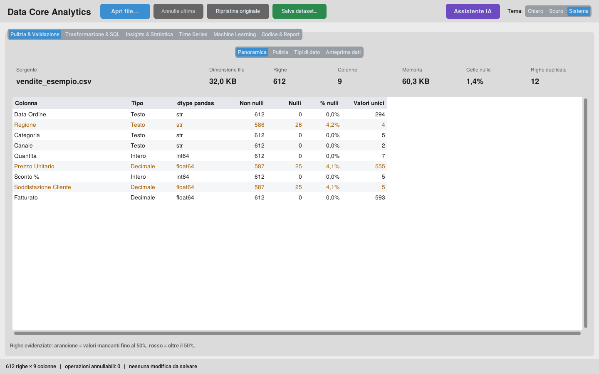

# Data Core Analytics

Piattaforma desktop (CustomTkinter) per pulizia, trasformazione, analisi statistica, time series,
machine learning e reporting di dataset CSV, Excel, Parquet, SQLite e PostgreSQL, con una
**catena di agenti IA** che porta da una domanda di business a un report verificato.

**[Prova la demo](https://andreapollastrelli95.github.io/data-core-analytics/)** · pulizia dati, statistiche, previsioni e regressione calcolate nel browser su un dataset inventato. Tutti i dati sono fittizi.




Nella cartella `esempi/` c'è un dataset di vendite inventato (con valori mancanti e duplicati) per provare tutte le funzioni.

## Avvio

- **Doppio clic su `run.bat`**: avvia l'app senza finestra del terminale.
- Da terminale: `.venv\Scripts\python main.py`
- Eseguibile autonomo: `build_exe.bat` → `dist\DataCoreAnalytics.exe`

Prima installazione (Python ufficiale di Windows, non quello di MSYS2):

```powershell
python -m venv .venv
.venv\Scripts\python -m pip install -r requirements.txt
```

## Struttura

| File | Ruolo |
|---|---|
| `main.py` | Finestra principale: stato condiviso, cronologia/annulla, esecuzione in background, gestione errori |
| `gui/tab_*.py` | Le 7 schede dell'interfaccia; `gui/widgets.py` contiene tabelle, grafici e liste riutilizzabili |
| `cleaner.py` | Caricamento file, pulizia, conversione dei tipi, esportazione |
| `transform_engine.py` | Join, concat, group by |
| `sql_engine.py` | Query DuckDB sui DataFrame, import da SQLite e PostgreSQL |
| `stats_engine.py` | Statistiche descrittive, correlazioni, outlier, test d'ipotesi, grafici |
| `ts_engine.py` | Ricampionamento, scomposizione trend/stagionalità, previsioni |
| `ml_engine.py` | Addestramento e valutazione modelli scikit-learn |
| `report_engine.py` | Report HTML ed Excel multi-foglio |
| `codegen.py` | Registro delle operazioni e generazione dello script Python |
| `ai_tools.py` | Strumenti che l'IA può chiamare: ognuno esegue un motore dell'app, in sola lettura |
| `agent_engine.py` | Analisi guidata: controllo dati → analisi → revisore → report |
| `review_engine.py` | Revisore automatico: riproducibilità, totali, join, numeri del testo |
| `context_store.py` | Dizionario dati per dataset e procedure di analisi salvate |
| `tests/` | Test automatici dei motori, dell'analisi guidata e dell'interfaccia |

I moduli `*_engine.py`, `cleaner.py`, `codegen.py`, `ai_tools.py` e `context_store.py` non dipendono
dalla GUI: ogni operazione restituisce il nuovo DataFrame più il codice pandas equivalente.

## Analisi guidata: dalla domanda al report verificato

Scheda **«Analisi guidata»**: scrivi una domanda di business (o scegli una procedura) e l'app esegue
una catena di quattro agenti. Ogni passo finisce nel registro con il codice Python che lo riproduce.

| Agente | Che cosa fa | Usa l'IA? |
|---|---|---|
| 1. Controllo dati | Duplicati, valori mancanti, valori scritti in più modi, numeri e date salvati come testo, valori estremi e negativi | No, in locale |
| 2. Analisi | Gemini sceglie i calcoli; **l'app li esegue** sui dati con i propri motori (SQL DuckDB, aggregazioni, statistiche, correlazioni, test d'ipotesi, outlier, serie temporali, previsioni) | Sì, per scegliere |
| 3. Revisore | Riesegue ogni calcolo, riconcilia i totali, controlla le chiavi dei join e confronta **ogni numero del testo** con i risultati calcolati; poi una seconda lettura critica indipendente | Controlli in locale + 1 chiamata |
| 4. Report | Risposta in breve, evidenze, qualità dei dati, ipotesi e limiti, prossimi passi, più la sezione «Verifiche automatiche» scritta dal codice | Sì, per scrivere |

Scelte di progetto:

- **I numeri li calcola l'app, non il modello.** Il modello chiama strumenti (`ai_tools.py`) e riceve i
  risultati; un numero scritto nel report che non compare nei risultati viene segnalato come errore.
- **Sola lettura e isolamento.** Gli strumenti non modificano mai il dataset. Le query SQL scritte
  dal modello girano con l'accesso ai file disattivato: vedono solo i dati caricati nell'app.
- **Consumo limitato.** Al massimo 6 chiamate a Gemini per analisi (fino a 4 per l'analisi, 1 per il
  revisore, 1 per il report), compatibili con il piano gratuito.
- **Privacy.** Al modello vanno la struttura delle colonne (nomi, tipi, minimo e massimo, valori
  delle colonne con poche categorie) e i risultati dei calcoli che richiede: tabelle fino a 40 righe,
  che possono contenere righe del dataset. Le righe di esempio iniziali solo se lo chiedi. Prima
  dell'invio l'app chiede conferma.
- **«Solo controllo dati»** esegue il primo agente senza chiave e senza inviare nulla.

**Dizionario dati.** Per ogni dataset puoi descrivere il significato delle colonne, la definizione
delle metriche (es. «Scontrino medio: Fatturato diviso numero di ordini») e le regole di business.
Il dizionario viene dato al modello a ogni analisi e ha la precedenza sulle sue ipotesi.

**Procedure salvate.** Cinque analisi pronte (report di sintesi, andamento nel tempo, confronto tra
segmenti, cosa guida la metrica, valori anomali) più quelle che salvi tu, rieseguibili con un clic su
qualsiasi dataset. Dizionari e procedure sono salvati in `~/.data_core_analytics` (mai nel repository).

Il report si esporta in HTML (con appendice di tutti i passi, tabelle e codice) o in Markdown.

## Le 7 schede

1. **Pulizia & Validazione** — panoramica (righe, colonne, memoria, % nulli, duplicati, tipi per colonna),
   snake_case, eliminazione colonne, valori mancanti (elimina / media / mediana / moda / valore),
   duplicati, trim dei testi, **conversione forzata dei tipi** (float, int, datetime con formato
   personalizzato, testo, booleano, categoria) con anteprima e modalità rigorosa.
2. **Trasformazione & SQL** — dataset secondario, join Left/Right/Inner/Outer su più chiavi, concat
   verticale, group by multi-colonna con più metriche, **editor SQL DuckDB** (`df` = principale,
   `df2` = secondario), import da SQLite e PostgreSQL.
3. **Insights & Statistica** — percentili, skewness, kurtosis, memoria; matrice di correlazione
   Pearson/Spearman/Kendall con p-value; outlier IQR/Z-score (rimozione o winsorizzazione);
   test di normalità, t-test, ANOVA, chi-quadrato, test di correlazione; istogrammi, boxplot,
   scatterplot, grafici a barre.
4. **Time Series** — rilevamento delle colonne data, aggregazione oraria → annuale, scomposizione
   additiva/moltiplicativa, previsione con media mobile, Exponential Smoothing, Holt e Holt-Winters
   con validazione su holdout (MAE, RMSE, MAPE).
5. **Machine Learning** — target e feature, regressione lineare / Random Forest, logistica /
   Random Forest; RMSE, MAE, R², Accuracy, F1, Precision, Recall, ROC AUC; feature importance,
   predetto vs reale, matrice di confusione; aggiunta delle predizioni e salvataggio `.joblib`.
6. **Analisi guidata** — catena di agenti descritta sopra, dizionario dati e procedure salvate.
7. **Codice & Report** — script Python aggiornato in tempo reale (copia / salva `.py`), report HTML,
   report Excel multi-foglio, esportazione CSV / XLSX / Parquet, log delle operazioni.

Ogni modifica ai dati è annullabile (Ctrl+Z, fino a 15 passi) e lo script generato segue la cronologia.

## Assistente IA (chat)

Pulsante **«Assistente IA»** nell'intestazione: apre un pannello laterale disponibile da tutte le schede
(le analisi continuano a funzionare mentre l'assistente risponde).

L'assistente usa **Google Gemini** tramite il piano gratuito della Gemini API (SDK ufficiale
`google-genai`). Tutte le chiamate passano da `ai_engine.py`; il modello è indicato solo in
`ai_config.py` (`GEMINI_MODEL`, attualmente `gemini-3.8-flash`).

- **Chiave:** letta solo dalla variabile d'ambiente `GEMINI_API_KEY` (mai salvata dall'app).
  Creala gratis su [aistudio.google.com/apikey](https://aistudio.google.com/apikey) e impostala con
  `setx GEMINI_API_KEY "la-tua-chiave"`, poi riapri l'app. Nessuna fatturazione va attivata.
- **Allegati:** immagini (PNG, JPG, GIF, WEBP, max 5 MB), PDF (max 15 MB) e file di testo (TXT, CSV,
  MD, JSON, PY, SQL…).
- **Contesto del dataset:** opzione per allegare schema, statistiche e 20 righe del dataset corrente
  (disattivata di default).
- **Consumo ridotto:** si inviano solo gli ultimi 10 messaggi; allegati e contesto del dataset solo
  dell'ultima domanda che li conteneva. Nessuna chiamata automatica.
- **Affidabilità:** risposte in streaming, timeout di 90 s, fino a 3 tentativi per gli errori
  temporanei (rete, servizio non disponibile). Chiave mancante, limite gratuito raggiunto e assenza
  di rete producono un messaggio con la soluzione.
- **Privacy:** con il piano gratuito Google può usare richieste e risposte per migliorare i suoi
  servizi. Prima di inviare file o dati del dataset l'app chiede conferma: non inviare dati
  personali, finanziari o sanitari.
- Rendering Markdown, «Interrompi», «Copia risposta», «Nuova chat».

## Test

```powershell
.venv\Scripts\python -m pip install -r requirements-dev.txt
.venv\Scripts\python -m pytest
```

Oppure doppio clic su `esegui_test.bat`. I test coprono i motori (pulizia, trasformazioni, SQL,
statistica, serie temporali, machine learning, report), lo script generato (deve riprodurre i dati),
gli strumenti dell'IA, il revisore e l'intera analisi guidata con un modello simulato, quindi **non
consumano quota e non richiedono la chiave**. Vengono eseguiti anche a ogni push (GitHub Actions).

## Note tecniche

- Le operazioni pesanti girano in un thread separato: la finestra resta reattiva.
- Gli errori sui dati diventano messaggi chiari in un popup; l'app non si chiude mai per un'eccezione.
- La password PostgreSQL non viene salvata: lo script generato la legge da `PGPASSWORD`.
- Le versioni in `requirements.txt` sono fissate perché, con Smart App Control attivo, Windows
  bloccava le DLL di versioni pubblicate da poco (es. pandas 3.1).

---

Progetto di [Andrea Pollastrelli](https://andreapollastrelli95.github.io/).
