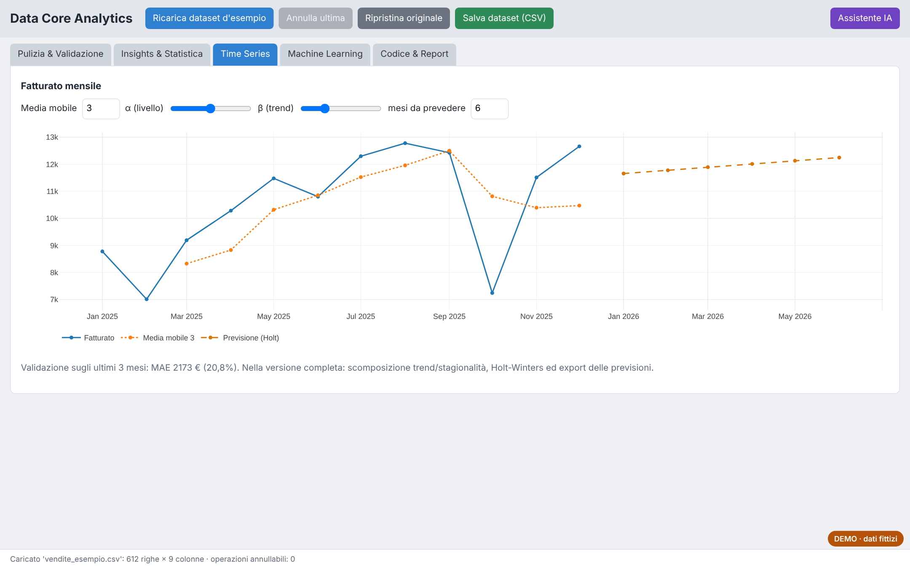

# Data Core Analytics

Piattaforma desktop (CustomTkinter) per pulizia, trasformazione, analisi statistica, time series,
machine learning e reporting di dataset CSV, Excel, Parquet, SQLite e PostgreSQL.

**[Prova la demo](https://andreapollastrelli95.github.io/data-core-analytics/)** · pulizia dati, statistiche, previsioni e regressione calcolate nel browser su un dataset inventato. Tutti i dati sono fittizi.




Nella cartella `esempi/` c'è un dataset di vendite inventato (con valori mancanti e duplicati) per provare tutte le funzioni.

## Avvio

- **Doppio clic su `run.bat`**: avvia l'app senza finestra del terminale.
- Da terminale: `.venv\Scripts\python main.py`
- Eseguibile autonomo: `build_exe.bat` → `dist\DataCoreAnalytics.exe`

Prima installazione (Python ufficiale di Windows, non quello di MSYS2):

```powershell
python -m venv .venv
.venv\Scripts\python -m pip install -r requirements.txt
```

## Struttura

| File | Ruolo |
|---|---|
| `main.py` | Finestra principale: stato condiviso, cronologia/annulla, esecuzione in background, gestione errori |
| `gui/tab_*.py` | Le 6 schede dell'interfaccia; `gui/widgets.py` contiene tabelle, grafici e liste riutilizzabili |
| `cleaner.py` | Caricamento file, pulizia, conversione dei tipi, esportazione |
| `transform_engine.py` | Join, concat, group by |
| `sql_engine.py` | Query DuckDB sui DataFrame, import da SQLite e PostgreSQL |
| `stats_engine.py` | Statistiche descrittive, correlazioni, outlier, test d'ipotesi, grafici |
| `ts_engine.py` | Ricampionamento, scomposizione trend/stagionalità, previsioni |
| `ml_engine.py` | Addestramento e valutazione modelli scikit-learn |
| `report_engine.py` | Report HTML ed Excel multi-foglio |
| `codegen.py` | Registro delle operazioni e generazione dello script Python |

I moduli `*_engine.py`, `cleaner.py` e `codegen.py` non dipendono dalla GUI: ogni operazione restituisce
il nuovo DataFrame più il codice pandas equivalente.

## Le 6 schede

1. **Pulizia & Validazione** — panoramica (righe, colonne, memoria, % nulli, duplicati, tipi per colonna),
   snake_case, eliminazione colonne, valori mancanti (elimina / media / mediana / moda / valore),
   duplicati, trim dei testi, **conversione forzata dei tipi** (float, int, datetime con formato
   personalizzato, testo, booleano, categoria) con anteprima e modalità rigorosa.
2. **Trasformazione & SQL** — dataset secondario, join Left/Right/Inner/Outer su più chiavi, concat
   verticale, group by multi-colonna con più metriche, **editor SQL DuckDB** (`df` = principale,
   `df2` = secondario), import da SQLite e PostgreSQL.
3. **Insights & Statistica** — percentili, skewness, kurtosis, memoria; matrice di correlazione
   Pearson/Spearman/Kendall con p-value; outlier IQR/Z-score (rimozione o winsorizzazione);
   test di normalità, t-test, ANOVA, chi-quadrato, test di correlazione; istogrammi, boxplot,
   scatterplot, grafici a barre.
4. **Time Series** — rilevamento delle colonne data, aggregazione oraria → annuale, scomposizione
   additiva/moltiplicativa, previsione con media mobile, Exponential Smoothing, Holt e Holt-Winters
   con validazione su holdout (MAE, RMSE, MAPE).
5. **Machine Learning** — target e feature, regressione lineare / Random Forest, logistica /
   Random Forest; RMSE, MAE, R², Accuracy, F1, Precision, Recall, ROC AUC; feature importance,
   predetto vs reale, matrice di confusione; aggiunta delle predizioni e salvataggio `.joblib`.
6. **Codice & Report** — script Python aggiornato in tempo reale (copia / salva `.py`), report HTML,
   report Excel multi-foglio, esportazione CSV / XLSX / Parquet, log delle operazioni.

Ogni modifica ai dati è annullabile (Ctrl+Z, fino a 15 passi) e lo script generato segue la cronologia.

## Assistente IA

Pulsante **«Assistente IA»** nell'intestazione: apre un pannello laterale disponibile da tutte le schede
(le analisi continuano a funzionare mentre l'assistente risponde).

L'assistente usa **Google Gemini** tramite il piano gratuito della Gemini API (SDK ufficiale
`google-genai`). Tutte le chiamate passano da `ai_engine.py`; il modello è indicato solo in
`ai_config.py` (`GEMINI_MODEL`, attualmente `gemini-3.8-flash`).

- **Chiave:** letta solo dalla variabile d'ambiente `GEMINI_API_KEY` (mai salvata dall'app).
  Creala gratis su [aistudio.google.com/apikey](https://aistudio.google.com/apikey) e impostala con
  `setx GEMINI_API_KEY "la-tua-chiave"`, poi riapri l'app. Nessuna fatturazione va attivata.
- **Allegati:** immagini (PNG, JPG, GIF, WEBP, max 5 MB), PDF (max 15 MB) e file di testo (TXT, CSV,
  MD, JSON, PY, SQL…).
- **Contesto del dataset:** opzione per allegare schema, statistiche e 20 righe del dataset corrente
  (disattivata di default).
- **Consumo ridotto:** si inviano solo gli ultimi 10 messaggi; allegati e contesto del dataset solo
  dell'ultima domanda che li conteneva. Nessuna chiamata automatica.
- **Affidabilità:** risposte in streaming, timeout di 90 s, fino a 3 tentativi per gli errori
  temporanei (rete, servizio non disponibile). Chiave mancante, limite gratuito raggiunto e assenza
  di rete producono un messaggio con la soluzione.
- **Privacy:** con il piano gratuito Google può usare richieste e risposte per migliorare i suoi
  servizi. Prima di inviare file o dati del dataset l'app chiede conferma: non inviare dati
  personali, finanziari o sanitari.
- Rendering Markdown, «Interrompi», «Copia risposta», «Nuova chat».

## Note tecniche

- Le operazioni pesanti girano in un thread separato: la finestra resta reattiva.
- Gli errori sui dati diventano messaggi chiari in un popup; l'app non si chiude mai per un'eccezione.
- La password PostgreSQL non viene salvata: lo script generato la legge da `PGPASSWORD`.
- Le versioni in `requirements.txt` sono fissate perché, con Smart App Control attivo, Windows
  bloccava le DLL di versioni pubblicate da poco (es. pandas 3.1).

---

Progetto di [Andrea Pollastrelli](https://andreapollastrelli95.github.io/).
